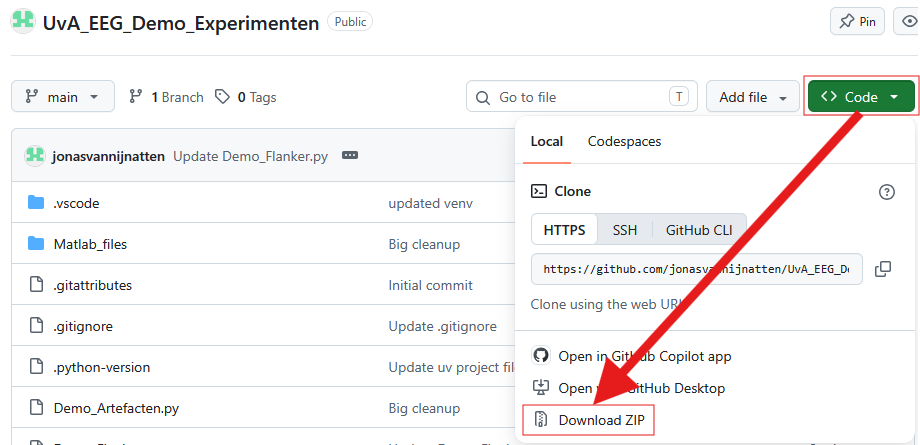

# 1. Install uv (if not yet installed)
Windows:  
`powershell -ExecutionPolicy ByPass -c "irm https://astral.sh/uv/install.ps1 | iex"`

MacOS & Linux:  
`curl -LsSf https://astral.sh/uv/install.sh | sh`

# 2. Download .zip file from Github  
* Download the project as .zip file  
* Unzip the file in a handy place  
  
  

# 3. Open VS Code in the correct folder
* Open VS Code  
* Click File > Open Folder  
* Select the folder where you just unzipped the project  

# 4. Sync environment as intended by instructor
Open a terminal in VS code and run:  
`uv sync`

# 5. Run your app/test/script
`uv run my-script`         # if defined in pyproject.toml [project.scripts]    
`uv run python script.py`  # for any script